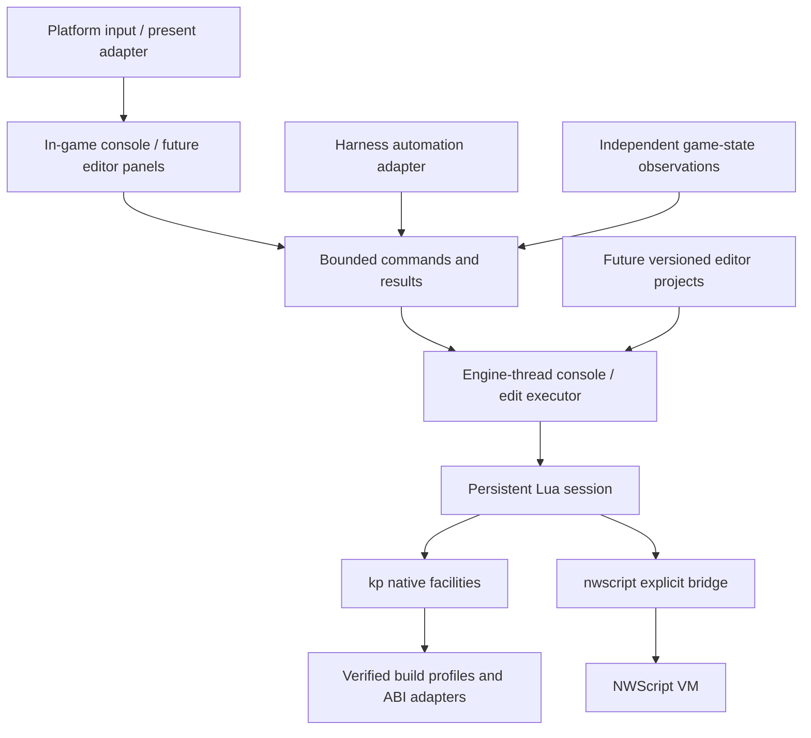

# KotOR live developer tools

Status: implementation design, 22 September 2026. The F12 console is the first delivery. The scene editor described below is a roadmap, not an implemented feature list. Live validation and supported platforms must be reported separately from build results.

## Product contract

Press **F12** in the running game to open developer tools. The first useful action is typing a Lua expression and immediately seeing its result. A modder can query a real object, apply a supported native change, see it in the game, inspect an error, and recover without restarting the session. F12 or Escape returns input to the game. Console input must never also move, attack, or activate a gameplay shortcut.

The initial surface is a readable command editor and scrollback over the game, with visible execution state and a short keyboard legend. It offers multiline entry, history, autocomplete, typed return values, output and errors. It does not display inactive scene-editor tabs. UI focus is explicit, shortcuts are discoverable, result types are visible without color, and completion never evaluates user expressions as the user types.

The long-term environment combines the immediacy of a developer console, a live scene inspector, camera composition and a reusable mod project. The game remains the rendering and behavior authority. Editor operations report actual observed outcomes rather than drawing a preview that merely assumes a write succeeded.

## Research and resulting decisions

Chrome DevTools demonstrates persistent command history, multiline entry, completion, output filtering and inspectable values. Adopt those interaction patterns, but do not copy JavaScript APIs into Lua or eagerly execute game expressions for preview. A call that looks like a query may mutate game state. [Chrome console reference](https://developer.chrome.com/docs/devtools/console/reference).

Godot distinguishes the local authored scene from the remote running scene and supports inspecting and changing live node properties. Adopt an explicit distinction between **live game state** and **saved project intent**. A runtime tweak does not silently become a persistent mod or an edit to the source save. [Godot debugging tools](https://docs.godotengine.org/en/stable/tutorials/scripting/debug/overview_of_debugging_tools.html).

Holocron Toolset/PyKotor already understand KotOR resource formats and module authoring. Integrate resource references and export/import boundaries instead of reimplementing an entire offline asset toolset inside a game DLL. Runtime object memory is not a substitute for the GFF/GIT/ARE/MDL resource formats. [PyKotor project](https://github.com/OpenKotOR/PyKotor).

Dear ImGui separates platform/input backends from rendering backends. Follow that boundary. Its capture flags do not suppress a game's independent DirectInput polling: the platform adapter must explicitly handle all input paths. Its OpenGL2 renderer also requires care with modern shader/VBO state; drawing an overlay must restore the game's graphics state. [Backend guide](https://github.com/ocornut/imgui/blob/master/docs/BACKENDS.md), [input capture FAQ](https://github.com/ocornut/imgui/blob/master/docs/FAQ.md), [OpenGL2 backend](https://github.com/ocornut/imgui/blob/master/backends/imgui_impl_opengl2.cpp).

## Blender-style UI and scripting parity

The user explicitly wants Lua to double as a comprehensive development environment. Adopt a shared operation model: selecting an object, editing a property, manipulating a gizmo, composing a camera or running a Lua command all operate on the same live objects and produce the same observable results. Every implemented editor operation should expose a scriptable equivalent and a **Copy as Lua** action. A reusable command history should let users turn a successful interactive experiment into a script.

Blender exposes data access alongside context-sensitive operators and records operators for reuse in scripts. For KotOR, keep data queries separate from mutations, and make operation preconditions explicit rather than depending invisibly on the currently focused panel. Only operations with validated inverse behavior enter undo history. [Blender API quickstart](https://docs.blender.org/api/current/info_quickstart.html), [operator system](https://developer.blender.org/docs/features/interface/operators/), [Python console](https://docs.blender.org/manual/en/latest/editors/python_console.html).

This is architectural parity, not a claim to have implemented Blender's breadth. Mesh/material authoring, rig editing, complete physics, arbitrary engine-memory rewind and offline resource baking require their own supported backends and remain separately gated. The immediate implementation stays the actual F12 Lua command loop.

## Ownership and architecture

- **Devtools core:** command IDs, persistent session, history, completion, bounded output, cancellation, structured results and future edit transactions. It owns no platform window and no harness listener.
- **Lua runtime:** actual Lua semantics and the existing common API initializer. The console does not create NWScript-equivalent functions or variables. Native facilities stay under `kp`; engine routines remain explicit `nwscript.call` operations.
- **Platform adapter:** F12, text/IME, clipboard, focus, keyboard/mouse capture, present hook, DPI and graphics-state preservation. It enqueues work; it does not execute Lua from input/render callbacks.
- **Build adapters:** image identity, offsets, pointer width, ABI and capability validation. An unavailable operation fails before mutation. A Mac profile does not imply a Darwin loader or working overlay.
- **Harness:** selects fixtures, drives actual keys when testing UI, submits through the same command service for repeatable behavior checks, reads results and independent state, and records video. TOML configures that driver only.
- **Project persistence (future):** versioned declarative scene intent and separately saved Lua source. It does not serialize a Lua VM heap, live pointers or opaque captures.

One engine-thread pump owns Lua execution. Input and rendering operate on synchronized snapshots and queues. Every submitted command has an ID and terminal success/error state. Bounded retention reports when older output is dropped. A runaway-Lua budget and cancellation protect the basic command loop; they cannot promise interruption of an arbitrary blocking native call. Native calls remain explicit operations with their own validation.

## First delivery: console

| Interaction | Required behavior |
|---|---|
| F12 / Escape | Open/close visibly; restore game input on close |
| Enter | Execute expression or complete statement |
| Multiline | Explicit newline/submission controls, shown in the UI |
| Up / Down | Recall command history without losing current input unexpectedly |
| Tab | Complete raw names/tables without invoking getters or metamethods |
| Output | Show print/stdout, stderr, typed return values, syntax errors and tracebacks |
| Persistent state | Variables and functions remain available across commands |
| Recovery | An error or bounded runaway does not destroy the console |
| Native integration | Same initialized kp and nwscript modules as scripts |
| Automated proof | Observe same-service results, plus physically type into the real overlay |

The first render/input adapter can be verified on the already available Windows K1 GOG build under Wine. Keep that label in every recording. Native macOS K1/K2 require their own actual loader, present/input adapters, supported binary acquisition and live tests; those remain tracked prerequisites.

## Roadmap and acceptance gates

### 1. Console usability and reusable scripts

Deliver the basic loop above, then searchable scrollback, severity filters, structured expandable values, named snippets, command palette, font/UI scaling, IME and platform clipboard validation. Add discoverable native capability help and explicit bridge documentation. Loading or reloading a script should show which callbacks were registered and what failed. Record example provenance through the same execution service.

Acceptance: an ordinary modder can reproduce a documented native example from F12, read errors, correct a command and restore the scene without restarting. Test accessibility keyboard-only and document screen-reader limitations honestly.

### 2. Live object tree and inspector

Enumerate the active module and typed objects with filters, type/tag/resource/position and identity validity. Selecting an object highlights the real rendered object. Read-only properties come first. Display both requested values and independently observed values for supported edits; unsupported fields remain read-only with reasons.

Acceptance: selection survives sorting/filtering; destroyed/replaced objects invalidate immediately; module transitions cannot leave a write targeting a recycled ID. Never store only a pointer or reuse a raw numeric ID as project identity.

### 3. Reversible edits and direct manipulation

Build each edit as resolve → validate → capture before-state → apply → observe → record. Add undo/redo only for operations with tested inverse behavior. A failed inverse stays visible. Support typed scale, position and animation controls already grounded in build profiles, then gizmos, axis constraints, snapping and multi-selection. Collision/use geometry is an independent check, not implied by a moved mesh.

Acceptance: dragging has immediate feedback; original game geometry and client/server state remain consistent; cancel restores the captured state; scene reload safely invalidates stale transactions. Irreversible commands are clearly identified and excluded from pretend undo.

### 4. Camera and animation composition

Add camera bookmarks, field-of-view controls where supported, stable orbit/free camera, subject framing, preview/restore, timelines and native animation clip controls. Keep gameplay camera ownership explicit; a game cutscene may retake it. Support safe shot transitions and actual-time recording without interpolation disguised as engine FPS.

Acceptance: a saved shot restores reproducibly for the same scene; closing tools restores the prior camera mode; module/cutscene changes terminate or rebind explicitly. Animation pause/resume must preserve clip time, not repeatedly restart the clip.

### 5. Saveable projects and mod export

A project stores schema version, game/build compatibility, resources, object selectors, required capabilities, ordered edit intent, camera shots and optional referenced Lua scripts. Keep executable scripts distinguishable from declarative data. Import validates schema and capabilities and produces a dry-run difference before applying. Export writes to a separate mod output directory; never silently overwrite the installed game or source save.

Use stable selectors such as module/resource/tag plus disambiguating position/type and authored ownership IDs. No pointer, capture userdata, process address or raw memory dump belongs in a portable project. Define migration rules and deterministic ordering before promising cross-version replay. Reconcile external changes rather than blindly replaying old inverses.

Acceptance: save → fresh session → load reproduces intended state with independent checks; missing resources and ambiguous selectors fail clearly; K1-only operations do not silently run in K2; failed imports leave a precise partial-application report and supported rollback.

### 6. Native Mac K1/K2 and reusable CI

Complete Darwin loading, image/slice identification, actual runtime ABI support, OpenGL present hook, Cocoa input/IME, focus and capture. Provision authorized Steam binaries through the established GitHub/Steam workflow without embedding credentials. Use self-hosted/compatible graphical runners as necessary and keep acquisition, offline gates, live behavior and visual review distinct.

Acceptance: F12, typed commands, input capture, native model/animation examples, restoration and actual high-FPS recordings pass on each named Mac build. Windows/Linux portability is demonstrated by adapters and tests, not inferred from shared C++.

## Evidence policy

A syntax pass, mock, successful command submission, engine-state predicate and clear video are different evidence. Keep them separate. Every accepted clip includes original continuous capture, exact runtime/example identities, outcome readbacks and a visual review of framing, cadence and comprehensibility. Do not call all 41 historical examples verified while their documented live obligations remain open.

## Familiar game-modding APIs and playback controls

Additional user requirements: draw on powerful Lua integrations such as Garry's Mod, and support idiomatic Ren'Py-like pause/play, save states and returning to prior dialog choices. These extend the same product; they do not replace the immediate F12 console acceptance.

Research should map familiar entities, hooks, timers and math patterns onto supported Hyperstim capabilities. Prefer consistent scoped modules, owned subscriptions and cancelable work. Do not clone every GMod global, shadow existing Lua facilities, introduce a parallel scheduler, or rename NWScript routines into a second engine facade. Unsupported operations must be explicit capabilities.

Playback needs a stronger state contract than a console transcript. A dialog checkpoint must identify the actual pre-choice game state, active module, resource/build identity and associated mod session. Returning to a choice may need restoration of quest variables, inventory, spawned/destroyed objects, party state, script state, timers and random state. A native save/load boundary can provide a coarse checkpoint where the game supports saving; it is not automatically a frame-accurate memory snapshot. Arbitrary Lua closure/FFI/native state cannot be promised serializable.

Start with verified pause/resume and named checkpoint lifecycle through a runtime-owned service. Keep harness transport and TOML as clients, not dependencies of player-facing Lua. Add dialog-choice history with checkpoint associations and explicit availability. A history entry with no restorable checkpoint is a transcript entry, not a rewind button. Future fine-grained rollback needs a measured state inventory, restoration coverage and round-trip tests with quest/inventory/script side effects.

## Shared browser and native developer-tools pipeline

The browser/WASM implementation must reuse the F12 command service. The browser console, an embedded editor, native overlay and harness are clients; none creates a second gameplay Lua state or evaluates commands on a rendering callback. Browser transport belongs outside Lua, NWScript and harness configuration.

The intended JavaScript surface is a small asynchronous client, for example `await kotor.lua.evaluate("kp.obj.pc()")`. This is a proposed interface until its adapter is implemented. It returns request-correlated results from the same runtime-owned execution queue. JavaScript remains JavaScript in Chrome's Console; the explicit Lua call selects the game scripting language. Do not replace browser globals, monkey-patch `console`, or translate NWScript names into JavaScript or Lua aliases.

A versioned transport contract must carry session identity, request identity, submission acceptance, terminal outcome, bounded output, completion and capability information. Worker messages are transport adapters over this contract. Reloads invalidate old requests and object references; queue rejection, output loss, disconnects and unsupported operations must be visible. Completion and inspection do not execute arbitrary getters or Lua metamethods. Structured inspection requires typed values and session-bound references; parsing pretty-printed text is not an object protocol.

Chrome DevTools should expose ordinary inspectable JavaScript results, useful error stacks, source-linked browser adapter code and WASM debugging information where supported. Native browser debugging and Lua source-level breakpoints are distinct capabilities. Lua stepping, paused-frame inspection and breakpoints require a runtime debugger adapter and remain explicitly unavailable until implemented and tested. A JavaScript pause must not be presented as a reversible game checkpoint.

Acceptance includes a cross-client round trip: a value assigned through F12 is read and modified by a browser client, then observed through F12 in the same session; commands retain ordering, output attribution, cancellation semantics and error recovery. Browser worker tests and native service tests are preliminary evidence. Full browser-game acceptance still requires authentic game execution, graphics, input, audio and save/load for each supported corpus variant.

### Playable browser delivery and locally supplied game data

The browser objective is a playable K1/K2 game, comparable in purpose to [KotOR.js](https://github.com/KobaltBlu/KotOR.js), with the shared live developer tools connected to that game. A parser, console page, streamed desktop, CPU function trace or static scene is an intermediate result and cannot satisfy this objective. KotOR.js is a researched comparator; this document does not adopt its implementation or claim feature parity.

Deploy only authored runtime/application code and permitted dependencies. Retail game executables, archives, textures, models, audio, movies, scripts, saves, extracted resources and corpus-derived proprietary source or instruction payloads must not enter GitHub, published bundles, source maps, CI artifacts or a site deployment. Build/deploy inputs must use an explicit allowlist, with synthetic fixtures in public tests and private local game inputs outside the publish root. Merely adding ignore patterns is insufficient: validate the actual output package. No publication is authorized by this implementation task.

The player chooses an existing installation with a visible **Choose game folder** action. Read the granted folder locally and lazily through a game-data provider; do not upload files or copy the installation into a server dataset. Validate K1/K2 resource layout and variant capabilities before enabling Play. Show readable errors for denied access, missing files, unsupported variants and expired permissions. Keep game assets read-only and save/mod output in separate local browser storage with explicit import/export. Chrome requires user-granted file access in a secure context; other browser capabilities need feature detection and a clearly described local-file fallback. [Chrome File System Access documentation](https://developer.chrome.com/docs/capabilities/web-apis/file-system-access).

The platform keyboard adapter must respect browser shortcuts: native F12 opens the in-game overlay; browser F12 remains Chrome DevTools. The browser game exposes a visible developer-tools button and a separately documented non-conflicting shortcut. Both interfaces reach the same console service and session. A user can inspect the browser API in Chrome while the embedded game editor shows the corresponding results and live state.
