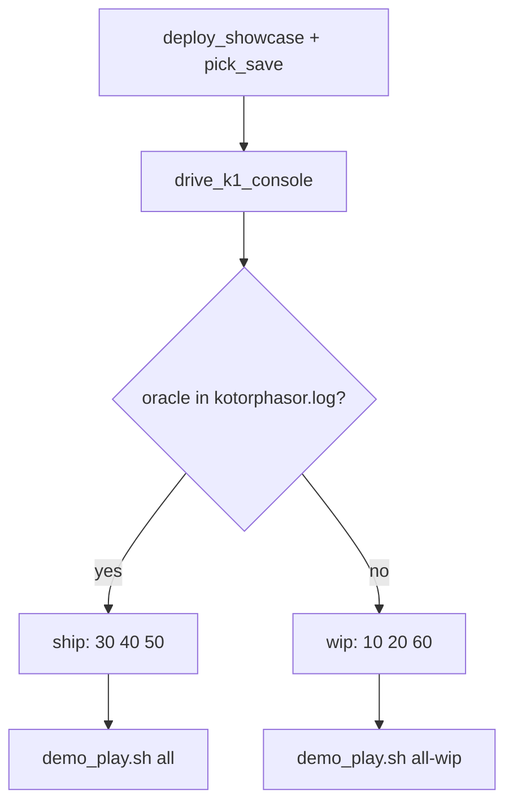

# Showcase demo playbooks

Six example scripts live under `scripts/examples/showcase/`. Only three are
release-gated: `demo_play.sh all` and `record_showcase.sh all` run **30 / 40 /
50**. The other three stay callable by name (or `demo_play.sh all-wip`) until
their oracles pass on a real boot.

| Demo | Status | Oracle seen on a real run |
|---|---|---|
| `30_battle_meditation` | **ship** | `[meditation] round N: steadied` |
| `40_alignment_drift` | **ship** | `[conscience] +N, now N` |
| `50_enclave_arrival` | **ship** | `[arrival] dan` / `[arrival] man` |
| `10_ahto_city_law` | wip | no — needs PC as attacker on `manm26ad`; boots also flake |
| `20_sith_patrol_alarm` | wip | no — `GetLastPerceived == PC` is flaky under headless drive |
| `60_party_wounded` | wip | lua-only yes; full `demo_play` recording not reliable |

Workflow:

1. `./scripts/harness/pick_save.sh <label>`
2. `./scripts/harness/deploy_showcase.sh <basename>`
3. `RECORD=0 GAME_DIR=tmp/k1_harness OUT=tmp/discover/<id> ./scripts/harness/live_session.sh`
4. Append commands to `$OUT/queue`; assert on `tmp/k1_harness/kotorphasor.log`
5. When stable, record: `./scripts/harness/demo_play.sh <basename>`

