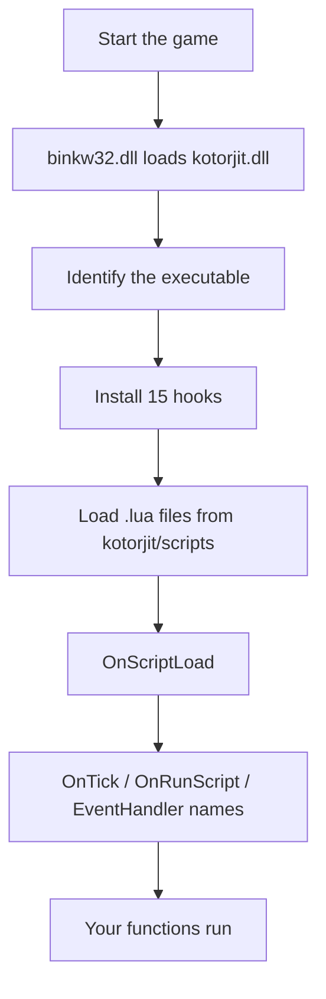

# Use KotorJIT 0.1.0

KotorJIT is a Lua host that loads with Knights of the Old Republic. It sees the game's own script events and lets you call most engine routines from Lua.

This folder is for people writing scripts. Internal design notes stay in `docs/` next to this directory.
Where months of KotOR reverse-engineering / byte-exact recovery live:
[agentdecompile-authority.md](../agentdecompile-authority.md)
(NVMe AIO: `~/agentdecompile-nvme/AIO/AUTHORITY.md`).



## Start here

1. [Install the runtime](install.md)
2. [Write a script](scripts.md)
3. [See what is live](api-status.md)
4. [Find a codecave](codecaves.md) if you need somewhere to put injected bytes
5. [Test the game without a screen](harness.md)
6. [Platform profiles (Win/Mac identity)](platform-profiles.md)

The same native harness controls are available to loaded Lua scripts under
[`kp.harness`](../lua-harness-api.md).

Generated argument lists live in [../lua-api.md](../lua-api.md) (events) and [../nwscript-api.md](../nwscript-api.md) (engine routines). Those files list every name in the contract. They do not say which names fire today. Use [api-status.md](api-status.md) for that.

## What's supported

KOTOR 1 (GOG and Steam, Windows) and KOTOR 2 (GOG/Steam Aspyr on Windows) install and run scripts today. Other corpus builds remain fail-closed until target-native bindings are recovered. The full list, with the one open caveat for K2 (typed struct access is unverified there), is in [../../CONTRIBUTING.md](../../CONTRIBUTING.md#supported-builds).

The Steam K1 executable is encrypted on disk. The runtime waits until the game deciphers itself, then checks the image hash before it patches anything. An unknown build is left alone.

## Read the log

After a boot, open `<game>/kotorjit.log`. A healthy start looks like this:

```
KotorJIT 0.1.0 starting
installed 15 hooks
api: registered nwscript.call for 769 engine routines
running: build k1_steam_103_unpacked, 15 hooks, N script(s)
```

If install fails, the log says so and the game runs without the mod.
