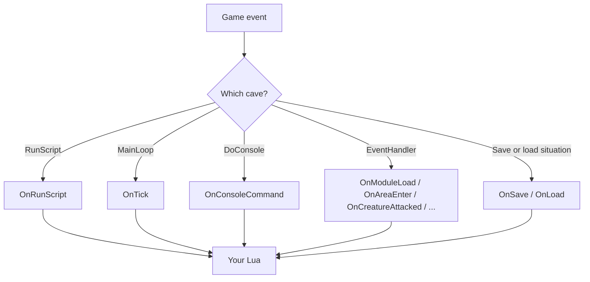

# API status (0.1.0)

What a script can receive and call on KOTOR 1 Steam Windows (`k1_steam_103_unpacked`). Status is from the 0.1.0 runtime and a live harness boot that installed 15 hooks.

Generated catalogs ([../lua-api.md](../lua-api.md), [../nwscript-api.md](../nwscript-api.md), `data/hostapi.toml`) list more names than this file. This file is the one that says whether the name runs.

## Status key

| Tag | Meaning |
|---|---|
| **Live** | Seen working in `kotorphasor.log` or `lua exec` |
| **Bound** | Installed or registered; not individually proven in-game |
| **Dead name** | Listed in `events.toml`; C++ never calls that function |
| **Unhooked** | Address known; no detour in 0.1.0 |
| **Omitted** | Engine has it; Lua does not bind it |
| **Spec** | Named in `data/hostapi.toml` only |
| **Flaky** | Callable; result is unreliable |

---

## Console commands

| Command | Status |
|---|---|
| `lua exec <code>` | Live |
| `lua status` | Live |
| `lua reload` | Live |

---

## Script globals

| Name | Status |
|---|---|
| `priority` | Live |
| `print(...)` | Live |
| `_HOST`, `_SERVERAPP` | Bound |
| `_GAME` | Bound |
| `api_version` | Bound (`1`) |
| `_KP_VERSION`, `kp.version` | Bound (`"0.1.0"`) |
| `cb` / `events` (111 `On*` integers) | Bound |
| `register_callback`, `unregister_callback` | Bound |
| `bit32` | Bound (alias of LuaJIT `bit`) |
| LuaJIT standard libraries | Bound |

---

## Codecaves

### Installed (15) — Live as a set

| Site | Feeds |
|---|---|
| `vm.run_script` | `OnRunScript`, `OnRunScriptDone` |
| `app.server_main_loop` | `OnTick`, timers |
| `console.do_console` | Console line + `lua *` |
| `event.creature` | Creature EventHandler names |
| `event.door` | Door EventHandler names |
| `event.placeable` | Placeable EventHandler names |
| `event.trigger` | Trigger EventHandler names |
| `event.module` | Module EventHandler names |
| `event.area` | Area EventHandler names |
| `event.encounter` | Encounter EventHandler names |
| `event.aoe` | AoE EventHandler names |
| `event.store` | Store EventHandler names |
| `event.waypoint` | Waypoint EventHandler names |
| `vm.save_script_situation` | `OnSave` |
| `vm.load_script_situation` | `OnLoad` |

### Call sites (not detours) — Bound / used Live

`vm.execute_command` and the twelve `vm.stack_push_*` / `vm.stack_pop_*` sites for integer, float, string, object, vector, and engine structure. All 13 resolved on this build.

### Unhooked

| Site | Notes |
|---|---|
| `vm.run_script_situation` | `DelayCommand` / `AssignCommand` resumes are invisible |
| `module.load_start` | Declared, not installed |
| `vm.execute_code` | Reference only |
| `app.client_main_loop` | Reference only |
| `console.funcs_add` | Unused; `DoConsole` already owns the line |

---

## Events (111)

### Runtime and always-on caves

| Callback | Status |
|---|---|
| `OnScriptLoad` | Live |
| `OnScriptUnload` | Bound |
| `OnTick` | Live |
| `OnRunScript` | Live |
| `OnRunScriptDone` | Bound |
| `OnConsoleCommand` | Live |
| `OnSave` | Live |
| `OnLoad` | Live |

### EventHandler names

The cave is installed. The Lua name fires when the engine raises that id.

**Creature (EventHandler)**

| Callback | Status |
|---|---|
| `OnCreaturePerception` | Bound |
| `OnCreatureSpellCastAt` | Bound |
| `OnCreatureDialogue` | Bound |
| `OnCreatureUserDefined` | Bound |
| `OnCreatureInventoryDisturbed` | Bound |
| `OnCreaturePathBlocked` | Bound |
| `OnCreatureAttacked` | Live (NPC victims only: it never dispatched for the player creature as `creature`, verified 2026-09-16; poll HP on `OnTick` for "the player got hit") |
| `OnCreatureTimedEvent` | Bound |
| `OnCreatureApplyEffect` | Bound |
| `OnCreatureRemoveEffect` | Bound |
| `OnCreatureRemoveFromArea` | Bound |
| `OnCreaturePlayAnimation` | Bound |
| `OnCreatureDestroy` | Bound |
| `OnCreatureSpellImpact` | Bound |
| `OnCreatureItemOnHitSpellImpact` | Bound |
| `OnCreatureForcedAction` | Bound |
| `OnCreatureBroadcastAOO` | Bound |
| `OnCreatureBroadcastSafeProjectile` | Bound |
| `OnCreatureFeedbackMessage` | Bound |
| `OnCreatureControllerRumble` | Bound |

**Module**

| Callback | Status |
|---|---|
| `OnModuleHeartbeat` | Bound |
| `OnModuleUserDefined` | Bound |
| `OnModuleLoad` | Live |
| `OnModuleStart` | Bound |
| `OnModulePlayerEnter` | Live |
| `OnModulePlayerExit` | Bound |
| `OnModuleActivateItem` | Bound |
| `OnModuleAcquireItem` | Live (2026-09-16: fires for `CreateItemOnObject` on the PC; fires more than once per item, debounce by item id) |
| `OnModuleLoseItem` | Bound |
| `OnModulePlayerDeath` | Bound |
| `OnModulePlayerDying` | Bound |
| `OnModuleRespawnButtonPressed` | Bound |
| `OnModulePlayerRest` | Bound |
| `OnModulePlayerLevelUp` | Bound |
| `OnModuleEquipItem` | Bound |
| `OnModuleDestroyPlayerCreature` | Bound |
| `OnModuleTimedEvent` | Bound |

**Area**

| Callback | Status |
|---|---|
| `OnAreaHeartbeat` | Bound |
| `OnAreaUserDefined` | Bound |
| `OnAreaEnter` | Live |
| `OnAreaExit` | Bound |
| `OnAreaSpawnBodyBag` | Bound |

**Door** — Bound:  
`OnDoorHeartbeat`, `OnDoorSpellCastAt`, `OnDoorDamaged`, `OnDoorDialogue`, `OnDoorDeath`, `OnDoorUserDefined`, `OnDoorDisarm`, `OnDoorTrapTriggered`, `OnDoorLocked`, `OnDoorUnlocked`, `OnDoorClicked`, `OnDoorFailToOpen`, `OnDoorOpen`, `OnDoorClose`, `OnDoorAttacked`, `OnDoorDestroy`

**Placeable** — Bound (except EndDialogue, dead below):  
`OnPlaceableHeartbeat`, `OnPlaceableSpellCastAt`, `OnPlaceableDamaged`, `OnPlaceableDialogue`, `OnPlaceableDeath`, `OnPlaceableUserDefined`, `OnPlaceableOpen`, `OnPlaceableClose`, `OnPlaceableDisarm`, `OnPlaceableUsed`, `OnPlaceableTrapTriggered`, `OnPlaceableInventoryDisturbed`, `OnPlaceableLocked`, `OnPlaceableUnlocked`, `OnPlaceableAttacked`, `OnPlaceableAcquireItem`

**Trigger** — Bound: `OnTriggerEnter`, `OnTriggerExit`, `OnTriggerUserDefined`, `OnTriggerDisarm`, `OnTriggerClicked`, `OnTriggerDestroy`

**Encounter** — Bound: `OnEncounterHeartbeat`, `OnEncounterEnter`, `OnEncounterExit`, `OnEncounterExhausted`, `OnEncounterUserDefined`

**AoE / store / waypoint** — Bound: `OnAoeEnter`, `OnAoeExit`, `OnStoreOpen`, `OnWaypointDestroy`

### Dead names

C++ only dispatches `OnRunScript` and `OnRunScriptDone` from `vm.run_script`. These function names never run. Match `script_name` instead.

| Dead Lua name | Typical `OnRunScript` resref |
|---|---|
| `OnCreatureHeartbeat` | `k_def_heartbt01`, `k_hen_heartbt01` |
| `OnCreatureSpawn` | `k_hen_spawn01` |
| `OnCreatureDamaged` | `k_def_damage01` |
| `OnCreatureDeath` | death script resref |
| `OnCreatureEndCombatRound` | `k_def_combend01` |
| `OnCreatureEndDialogue` | `k_def_dialogue01` |
| `OnPlaceableEndDialogue` | placeable dialog resref |
| `OnTriggerTrapTriggered` | trap script resref |
| `OnTriggerHeartbeat` | trigger heartbeat resref |
| `OnCreatureStateScript` | `statescripts.2da` resref |
| `OnAreaTransitionFail` | `k_trg_transfail` |
| `OnItemUse` | item-use resref |
| `OnClientRequestedScript` | client-requested resref |
| `OnDialogConditional` | dialog Active / StartingConditional resref |

Heartbeat, spawn, damage, death, end-of-round, and end-of-dialogue never reach `CSWSCreature::EventHandler`. `OnRunScript` is the only watch point for those slots.

---

## Host functions

### Bound

| Name | Status |
|---|---|
| `kotor.mem.readbit` / `readbyte` / `readchar` / `readword` / `readshort` / `readdword` / `readint` / `readfloat` / `readdouble` / `readstring` / `readwidestring` | Bound |
| `kotor.mem.writebit` / `writebyte` / `writechar` / `writeword` / `writeshort` / `writedword` / `writeint` / `writefloat` / `writedouble` / `writestring` / `writewidestring` | Bound |
| `kotor.mem.findsig` | Bound |
| `kotor.struct` / `kp.struct`: `at`, `view`, `types`, `fields`, `typeof`, `address`, `valid`, `size`, `how_to_obtain`, `allow_unverified_writes`, `totable`, `writes_performed` | Bound |
| `view.<field>` read and write | Bound |
| `kotor.obj` / `kp.obj`: `ready`, `valid`, `get`, `pc`, `party`, `party_size`, `party_member`, `party_slot`, `is_party_member`, `is_pc`, `name`, `tag`, `position`, `type`, `area`, `faction`, `find`, `INVALID` | Bound |
| Handle methods: `id`, `type`, `valid`, `name`, `tag`, `position`, `area`, `faction`, `is_pc`, `is_party_member`, `party_slot` | Bound |
| `kotor.log`, `kotor.console`, `kotor.feedback` | Bound |
| `kotor.registertimer`, `kotor.removetimer` | Bound |
| `kotor.tokenizestring`, `kotor.tokenizecmdstring` | Bound |
| `kp.as` | Bound |
| `kp.speed` | Bound |
| `kp.version` | Bound |
| `kp.gamedir`, `kp.time` | Bound |

`kotor.obj` and `kp.obj` are the same table. Same for `struct`. Memory is **`kotor.mem` only**.

Compat aliases (Bound, 28/28):  
`read_bit`, `read_byte`, `read_char`, `read_word`, `read_short`, `read_dword`, `read_int`, `read_float`, `read_double`, `read_string`, `read_wide_string`, `write_bit`, `write_byte`, `write_char`, `write_word`, `write_short`, `write_dword`, `write_int`, `write_float`, `write_double`, `write_string`, `write_wide_string`, `find_sig`, `log_msg`, `register_timer`, `remove_timer`, `tokenize_string`, `tokenize_cmd_string`

### Spec only (nil)

`kp.mem.*` (every spelling), `kp.mem.readbytes`, `kp.mem.writebytes`, `kp.mem.readable`, `kp.mem.writable`, `kp.mem.base`, `kp.mem.allow_code_writes`

`kp.obj.address`, `typed_address`, `typename`, `self`, `module`, `in_area`, `near`, `move`, `create`, `destroy`

`kp.print`, `kp.log`, `kp.echo`, `kp.tell`, `kp.say`, `kp.float_text`, `kp.speak`, `kp.console` (that last name would *run* a console line; `kotor.console` *writes* one), `kp.game_log`

`kp.timer.after`, `every`, `after_ticks`, `cancel`, `list`, `tick`, `clock`

`kp.str.split`, `cmdsplit`, `cexo`, `strref`

`kp.random`, `kp.build`, `kp.game`, `kp.scriptdir`, `kp.scriptname`, `kp.gametime`, `kp.vec`, `kp.routine`, `kp.routines`, `kp.engine_type`, `kp.vm_ready`

### Struct layouts (Bound)

25 layouts, 1521 fields:  
`CSWSCreature`, `CSWCCreature`, `CSWSCreatureStats`, `CSWSObject`, `CSWCObject`, `CGameObject`, `CSWSArea`, `CSWSModule`, `CSWSPlaceable`, `CSWSDoor`, `CSWSTrigger`, `CSWSItem`, `CItemRepository`, `CExoString`, `CExoArrayList`, `CExoLinkedList`, `CScriptEvent`, `CVirtualMachine`, `CVirtualMachineInternal`, `CServerExoApp`, `CAppManager`, `CGameObjectArray`, `CSWPartyTable`, `CGameEffect`, `C2DA`

Writes to medium or low confidence fields need `kotor.struct.allow_unverified_writes(true)`.

Effect, event, location, and talent userdata (`kp.effect`, `kp.event`, `kp.location`, `kp.talent`) are Bound as opaque handles.

---

## Engine routines `kotor.<Name>`

772 commands in the VM. **769 bound**. **3 omitted:**

| Id | Name | Status |
|---|---|---|
| 6 | `AssignCommand` | Omitted — use `kp.as` |
| 7 | `DelayCommand` | Omitted — use `kotor.registertimer` |
| 294 | `ActionDoCommand` | Omitted |

Vector and engine-struct routines are callable on this build (all marshallers resolved). Two distinct failure modes, not one:

* A routine call that **hard-faults** (bad pointer, access violation) is caught by the same guard as every other hook body: the fault is logged, and `set_live(false)` takes *all* Lua scripting out of service — not just the bridge — until `lua reload` rebuilds the Lua states. See `src/runtime/fault_guard.cpp`.
* A **stack imbalance** — a routine's handler consuming a different argument count than the bridge pushed, without ever hard-faulting — is silent. It corrupts the engine's own VM argument stack for every subsequent call, with no crash to catch and no accounting the bridge currently exposes to detect it (`VmBinding` in `src/api/routines.hpp` has no stack-depth query). There is no mechanism to recover from this today; it requires restarting the game.

### Proven in a running game (Live)

`ExecuteScript`, `GetCurrentHitPoints`, `GetMaxHitPoints`, `EffectDamage`, `GetGoodEvilValue`, `GetPartyMemberCount`, `GetIsDead`, `GetTag`, `GetObjectByTag`, `AdjustAlignment`, `ApplyEffectToObject`, `GetFirstPC`, `GetModuleName`, `IsObjectPartyMember`, `GetPartyMemberByIndex`

### Flaky

| Name | Notes |
|---|---|
| `ActionAttack` | Often no-ops while the console has focus |
| `EffectAttackIncrease` | Handle created; apply did not take in one live try |
| `AddPartyMember` | `lua exec` returned ok; party change not proven |

### Bound, not individually tested

Every other name in [../nwscript-api.md](../nwscript-api.md) for K1. The generated table starts at `Random` (id 0) and ends at `YavinHackCloseDoor` (id 771), skipping ids 6, 7, and 294.

K2 has a separate table (803 of 877). It is compiled in and callable: `k2_linux_swkotor2.elf`, `k2_win_gog_aspyr_swkotor2.exe`, and `k2_win_steam_aspyr_swkotor2.exe` all have every required hook site resolved and install cleanly (see `data/addresses/`). What is **not** verified for K2 yet: `kotor.struct`/`kp.struct`'s field offsets. `data/research/phasor_structs.json` was researched against K1's build only, so typed struct access on a K2 build is reading K1 offsets against a different binary and should not be trusted. Raw `kotor.mem.*` access, the routine bridge, and events are unaffected by this — they do not depend on struct field research.

---

## Counts

| Surface | Total | Live | Bound, untested | Dead / omitted / spec / unhooked |
|---|---|---|---|---|
| Codecaves | 33 | 15 detours + 13 call sites | — | 5 unhooked |
| Events | 111 | 10 | ~86 | 14 dead names |
| Console commands | 3 | 3 | — | — |
| Engine routines | 772 | 15 + 3 flaky | 751 | 3 omitted |
| Host names | ~90 specified | `print` live | ~50 bound | ~40 spec |
